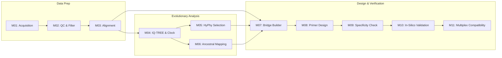

# 🧬 Evolutionary Diagnostic Pipeline for Emerging Pathogens

[](https://github.com/lab-biotek-bio-ugm/pandemic_prep_idn/actions/workflows/publish.yml)
[](https://snakemake.github.io)
[](https://www.python.org/)
[](https://pandemic-prep-docs.mintlify.site/)
[](https://pandemic.matinnu.org/)

An enterprise-grade, **Snakemake-orchestrated bioinformatics pipeline** designed for the rapid identification, validation, and thermodynamic design of diagnostic assays (PCR and RAA/RPA) resilient to mutational escape. 

This pipeline specifically targets **Acute Respiratory Infection (ARI) pathogens** (e.g., Influenza A, SARS-CoV-2) by coupling physical sequence conservation (Shannon Entropy) with phylogenetic phylodynamic mapping and selection pressure models. **M11: Multiplex Compatibility**: Pairwise and Triplex (three-way) thermodynamic cross-dimerization ($\Delta G$) screening across all oligo interactions, spectral dye channel separation (FAM vs. HEX vs. Cy5), and kinetic $T_m$ alignment.

---

## 🏛️ Collaborative Partners

Led and funded by UGM Faculty of Biology, BRIN Biomedical Research Center, and UI.

---

## ⚙️ Architecture & Data Flow

The workflow automatically streams raw surveillance data (NCBI/GISAID) and applies a 11-module bioinformatic cascade:



### Module Breakdown

1.  **M01–M02: Acquisition & Quality Control**: Automatic downloads and metadata-driven filtering (completeness, lineage distribution).
2.  **M03–M04: Phylodynamics**: Nextstrain/Augur integration, Maximum-Likelihood trees (IQ-TREE), and molecular clock temporal scaling.
3.  **M05–M06: Selection Pressure & Ancestral States**: HyPhy (FUBAR/MEME/GARD) codon selection models coupled with ancestral node reconstruction.
4.  **M07: Bridge Builder Scoring**: Proprietary scoring engine weighting Shannon entropy ($H$) against evolutionary purifying selection signals to locate stable diagnostic "bridges".
5.  **M08: Isothermal Primer Design**: PrimerLab engine wrapper applying thermodynamic constraints (Primer3 + ViennaRNA secondary structure minimization).
6.  **M09: Specificity Filtering**: In-depth BLAST verification (local/remote databases) generating GFF3/BED visual files and portable IGV sessions.
7.  **M10: In-Silico Validation**: Emulation of PCR/RAA amplification (seqkit amplicon) against massive surveillance cohorts, exporting interactive temporal dashboards.
8.  **M11: Multiplex Compatibility**: Dual-target and Triplex (three-way) heterodimerization ($\Delta G$) screening across all oligo interactions, dye channel separation (FAM vs. HEX vs. Cy5), and kinetic $T_m$ alignment.

---

## 🚀 Quickstart

For detailed steps, refer to the [Quickstart Guide](docs/getting-started/quickstart.md).

### 1. Prerequisites
Ensure you have Conda or Mamba installed.
```bash
# Clone the repository
git clone https://github.com/lab-biotek-bio-ugm/pandemic_prep_idn.git
cd pandemic_prep_idn

# Create the master environment
conda env create -f environment.yml
conda activate pandemic-prep
```

### 2. Configure Your Run
Target parameters, sequence counts, and database choices are configured in `config/config.yaml`.
Multi-target presets are available:
*   `config/config_influenza_a_mp.yaml` (Dye: FAM)
*   `config/config_influenza_b_mp.yaml` (Dye: HEX)
*   `config/config_measles_all_partial.yaml` (Dye: Cy5)

### 3. Execute Single-Target Pipeline
Run a dry-run to verify rule dependencies:
```bash
snakemake --use-conda -n
```
Execute with 16 cores:
```bash
snakemake --use-conda --cores 16 --configfile config/config_influenza_a_mp.yaml
```

### 4. Multi-Target Batching & Multiplex/Triplex Screening
To batch-execute multiple target configs sequentially and automatically run Module 11 Multiplex Compatibility screening, use the master orchestrator script:

#### Pairwise Multiplex Screening:
```bash
# Batch run across Influenza A and Influenza B configs with 64 cores
bash scripts/run_multiplex_batch.sh config/config_influenza_a_mp.yaml config/config_influenza_b_mp.yaml --use-conda -c 64
```

#### Triplex Multiplex Screening (All 3 Targets):
If three target configurations are provided, the orchestrator automatically runs a three-way thermodynamic and kinetic compatibility check using `scripts/m11_triplex_checker.py`:
```bash
python scripts/run_multiplex_batch.py \
  --configs config/config_influenza_a_mp.yaml config/config_influenza_b_mp.yaml config/config_measles_all_partial.yaml \
  --cores 64 \
  --skip-snakemake
```

---

## 📁 Key Outputs

Key diagnostic assets are written directly to `results/{BUILD}/`:

*   **Conserved targets**: `results/{BUILD}/m07/bridge_report.json`
*   **Designed Primers**: `results/{BUILD}/m08/summary.json` (ranked candidate list)
*   **BLAST Tracks**: `results/{BUILD}/m09/final_candidates.gff3` / `.bed`
*   **IGV Workspace**: `results/{BUILD}/m09/igv_session.xml` (one-click visualization setup)
*   **Validation Dashboard**: `results/{BUILD}/m10/validation_report.html`
*   **Pairwise Multiplex Results**: `results/multiplex-<targetA>_x_<targetB>/multiplex_report.md`
*   **Triplex Multiplex Results**: `results/multiplex-triplex-all-3/triplex_report.md` & `triplex_candidates.json`

---

## 📚 Documentation Index

Our comprehensive documentation is deployed at [pandemic-prep-docs.mintlify.site](https://pandemic-prep-docs.mintlify.site) (configured in `docs/`):

*   [**Getting Started**](docs/getting-started/quickstart.md) — Environmental configuration, dry-runs, and dependencies.
*   [**Configuration Manual**](docs/getting-started/configuration.md) — Clock rate reference tables, target-subsampling, and thresholds.
*   [**Bridge Builder scoring (M07)**](docs/pipeline-architecture/m07-bridge-builder.md) — Conservation and purifying selection algorithms.
*   [**Thermodynamic Design (M08)**](docs/pipeline-architecture/m08-primer-design.md) — RAA isothermal parameters and hairpin loops.
*   [**Troubleshooting**](docs/operations/troubleshooting.md) — Resolving common clock-rate outliers, memory faults, and local BLAST path issues.
*   [**Developer Guide**](docs/development/developer-guide.md) — Coding conventions, Snakefile coding rules, and PR checklist.

---

## 📄 License
This project is licensed under the terms of the license pending institutional review.
