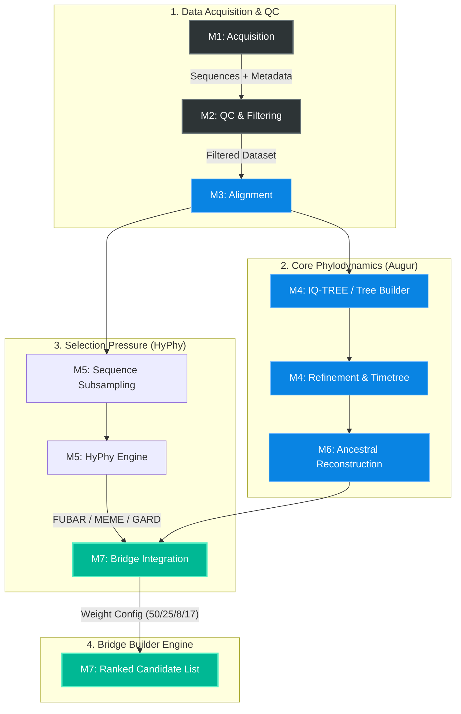

# Evolutionary Diagnostic Pipeline for Pandemic Preparedness

## Overview

This repository hosts a state-of-the-art bioinformatics pipeline designed for the rapid identification and validation of robust diagnostic targets in emerging pathogens. This project is part of a strategic initiative led by the **National Research and Innovation Agency (BRIN)** through the **Biomedical Research Center (PR Biomedis)**, in collaboration with **Universitas Gadjah Mada (UGM)**, Universitas Indonesia (UI), and international partners from the University of Bern and Tokyo University of Agriculture and Technology.

The pipeline specifically addresses the challenges of detecting **Acute Respiratory Infection (ARI)** pathogens with pandemic potential, such as Influenza A and SARS-CoV-2, by integrating physical sequence conservation with evolutionary selection pressure signals.

---

## Technical Architecture

The system is orchestrated via **Snakemake** and organized into several core modules (M1-M7) that transform raw genomic surveillance data into ranked diagnostic candidates.

### Pipeline Flow (M1 – M7)



### Key Modules

1. **Data Acquisition & QC (M1-M2)**: Automated retrieval from NCBI/GISAID with rigorous filtering for sequence quality and metadata completeness.
2. **Phylodynamic Analysis (M3-M4)**: Leveraging the **Nextstrain/Augur** engine for high-resolution phylogenetic reconstruction and spatio-temporal dynamics.
3. **Selection Pressure Engine (M5)**: Utilizing **HyPhy (FUBAR, MEME, GARD)** to identify sites under purifying, episodic, and diversifying selection.
4. **Bridge Builder Engine (M7)**: A proprietary integration module that scores regions based on weighted physical stability (conservation) and evolutionary robustness (avoidance of mutational hotspots).

---

## Tech Stack

- **Workflow Orchestration**: Snakemake
- **Phylogenetics**: Augur (Nextstrain), IQ-TREE, MAFFT
- **Evolutionary Biology**: HyPhy (Hypothesis Testing using Phylogenies)
- **Environment Management**: Conda / Mamba
- **Language**: Python 3.10+

---

## Getting Started

### Prerequisites

- Linux/WSL2 or MacOS
- Conda or Mamba (recommended)

### Installation

1. Clone the repository:

   ```bash
   git clone https://github.com/lab-biotek-bio-ugm/pandemic_prep_idn.git
   cd pandemic_prep_idn
   ```

2. Set up the core environment:

   ```bash
   conda env create -f workflow/envs/environment.yaml
   conda activate pandemic-prep
   ```

### Running the Pipeline

Configure your target pathogen in `config/config.yaml` and execute the pipeline:

```bash
snakemake --use-conda --cores 16
```

---

## Acknowledgments

This project is supported by the **Badan Riset dan Inovasi Nasional (BRIN)** under the 2026 Fiscal Year program: *"Peningkatan Kapasitas Laboratorium untuk Deteksi Patogen Berpotensi Pandemik bagi Human"*.

Collaborating Institutions:

- **BRIN** (Pusat Riset Biomedis)
- **Universitas Gadjah Mada (UGM)**
- Universitas Indonesia (UI)
- Telkom University
- University of Bern, Switzerland
- Tokyo University of Agriculture and Technology, Japan

---

## License

License details pending institutional review.
