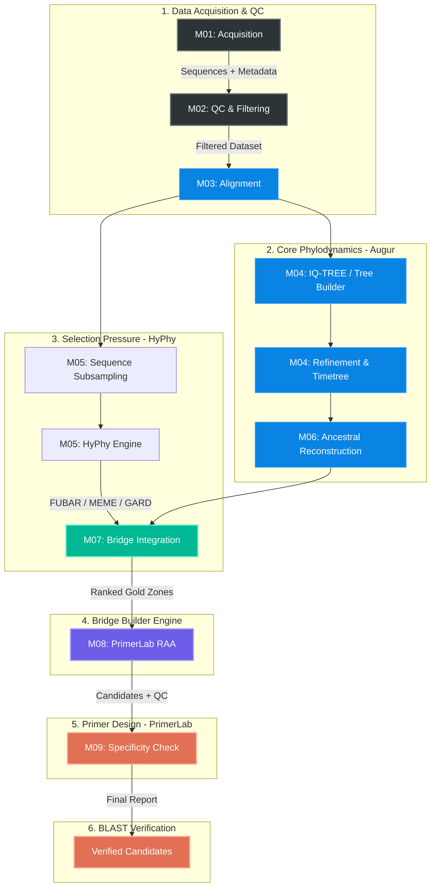

# Evolutionary Diagnostic Pipeline for Pandemic Preparedness

## Overview

This repository hosts a state-of-the-art bioinformatics pipeline designed for the rapid identification and validation of robust diagnostic targets in emerging pathogens. This project is part of a strategic initiative led by the **National Research and Innovation Agency (BRIN)** through the **Biomedical Research Center (PR Biomedis)**, in collaboration with **Universitas Gadjah Mada (UGM)**, Universitas Indonesia (UI), and international partners from the University of Bern and Tokyo University of Agriculture and Technology.

The pipeline specifically addresses the challenges of detecting **Acute Respiratory Infection (ARI)** pathogens with pandemic potential, such as Influenza A and SARS-CoV-2, by integrating physical sequence conservation with evolutionary selection pressure signals.

---

## Technical Architecture

The system is orchestrated via **Snakemake** and organized into nine core modules (M01-M09) that transform raw genomic surveillance data into verified, publication-ready diagnostic primer candidates.

### Pipeline Flow (M01 – M09)



### Key Modules

1. **Data Acquisition & QC (M01-M02)**: Automated retrieval from NCBI/GISAID with rigorous filtering for sequence quality and metadata completeness.
2. **Phylodynamic Analysis (M03-M04)**: Leveraging the **Nextstrain/Augur** engine for high-resolution phylogenetic reconstruction and spatio-temporal dynamics.
3. **Selection Pressure Engine (M05)**: Utilizing **HyPhy (FUBAR, MEME, GARD)** to identify sites under purifying, episodic, and diversifying selection.
4. **Annotation & Clade Assignment (M06)**: Ancestral sequence reconstruction and clade-based annotation via Augur/Nextclade.
5. **Bridge Builder Engine (M07)**: A proprietary integration module that scores regions based on weighted physical stability (conservation) and evolutionary robustness (avoidance of mutational hotspots). Produces entropy profiles, IUPAC-aware consensus sequences, and ranked candidate targets.
6. **PrimerLab RAA Design (M08)**: Integration with the [PrimerLab](https://github.com/lab-biotek-bio-ugm/primerlab-genomic) engine for isothermal (RAA/RPA) primer and probe design with Primer3 + ViennaRNA thermodynamic validation.
7. **BLAST Specificity Verification (M09)**: Post-design specificity check against human genome and respiratory virus databases (local or NCBI remote). Generates GFF3/BED tracks, IGV session files, and publication-ready candidate reports with GARD breakpoint cross-validation.

---

## Output Files

After a successful pipeline run, the key output files are:

| File | Module | Description |
|------|--------|-------------|
| `results/{BUILD}/m07/entropy_profile.tsv` | M07 | Per-position Shannon entropy with IUPAC bases |
| `results/{BUILD}/m07/bridge_report.json` | M07 | Scored & ranked conserved regions |
| `results/{BUILD}/m07/conserved_regions.bed` | M07 | BED track of conserved zones |
| `results/{BUILD}/m08/.../summary.json` | M08 | PrimerLab design summary |
| `results/{BUILD}/m08/.../alternatives.json` | M08 | Ranked primer candidates |
| `results/{BUILD}/m09/blast_specificity_summary.csv` | M09 | Master CSV comparing all candidates |
| `results/{BUILD}/m09/final_candidates.json` | M09 | Verified candidates (PASS/BORDERLINE) |
| `results/{BUILD}/m09/final_candidates.gff3` | M09 | GFF3 track for IGV visualisation |
| `results/{BUILD}/m09/final_candidates.bed` | M09 | BED track for IGV/UCSC |
| `results/{BUILD}/m09/igv_session.xml` | M09 | Pre-configured IGV session |
| `results/{BUILD}/m09/final_candidates_report.md` | M09 | Human-readable final report |

---

## Configuration

### Multi-Target Support

The pipeline supports multiple target configurations:

- `config/config.yaml` — Default/global configuration
- `config/config_influenza_a_mp.yaml` — Influenza A (MP segment) with custom local BLAST DB
- `config/config_influenza_a_np.yaml` — Influenza A (NP segment)

To run with a specific config:
```bash
snakemake --use-conda --cores 16 --configfile config/config_influenza_a_mp.yaml
```

### Key Parameters

| Parameter | Location | Description |
|-----------|----------|-------------|
| `num_candidates` | M08 design | Number of Primer3 candidates to generate |
| `vienna_ranking_limit` | M08 design | How many candidates get ViennaRNA evaluation |
| `blast_verification.num_candidates` | M09 | How many top candidates get BLAST verified |
| `blast_verification.mode` | M09 | `remote` (NCBI) or `local` (custom DB) |

---

## Tech Stack

- **Workflow Orchestration**: Snakemake
- **Phylogenetics**: Augur (Nextstrain), IQ-TREE, MAFFT
- **Evolutionary Biology**: HyPhy (Hypothesis Testing using Phylogenies)
- **Primer Design**: PrimerLab (Primer3 + ViennaRNA)
- **Specificity**: BLAST (local & NCBI remote)
- **Visualization**: matplotlib, IGV
- **Environment Management**: Conda / Mamba
- **Language**: Python 3.10+

---

## Getting Started

### Prerequisites

- Linux/WSL2 or MacOS
- Conda or Mamba (recommended)

### Installation

1. Clone the repository:

   ```bash
   git clone https://github.com/lab-biotek-bio-ugm/pandemic_prep_idn.git
   cd pandemic_prep_idn
   ```

2. Set up the core environment:

   ```bash
   conda env create -f workflow/envs/environment.yaml
   conda activate pandemic-prep
   ```

### Running the Pipeline

Configure your target pathogen in `config/config.yaml` and execute the pipeline:

```bash
snakemake --use-conda --cores 16
```

### Visualising Results

After the pipeline completes:

1. **Entropy Plot**: Generate a publication-quality entropy profile:
   ```bash
   python scripts/m07_plot_entropy.py \
       --entropy-tsv results/{BUILD}/m07/entropy_profile.tsv \
       --bridge-json results/{BUILD}/m07/bridge_report.json \
       --candidates results/{BUILD}/m09/final_candidates.json \
       --outdir results/{BUILD}/plots \
       --format png
   ```

2. **IGV Visualization**: Open the pre-configured IGV session:
   ```
   File → Open Session → results/{BUILD}/m09/igv_session.xml
   ```

---

## Acknowledgments

This project is supported by the **Badan Riset dan Inovasi Nasional (BRIN)** under the 2026 Fiscal Year program: *"Peningkatan Kapasitas Laboratorium untuk Deteksi Patogen Berpotensi Pandemik bagi Human"*.

Collaborating Institutions:

- **BRIN** (Pusat Riset Biomedis)
- **Universitas Gadjah Mada (UGM)**
- Universitas Indonesia (UI)
- Telkom University
- University of Bern, Switzerland
- Tokyo University of Agriculture and Technology, Japan

---

## License

License details pending institutional review.
