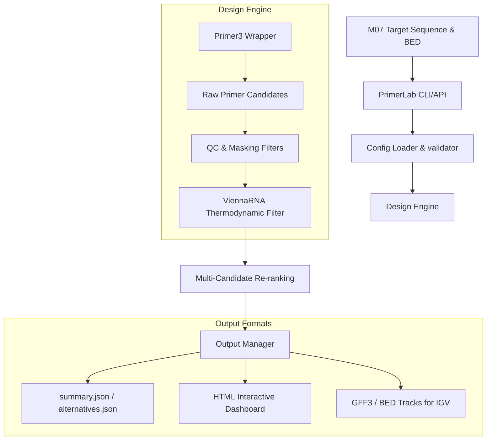

# PrimerLab Genomic Framework

**PrimerLab Genomic** is a modular, high-performance bioinformatics framework for automated primer and probe design in molecular biology workflows. It acts as the thermodynamic design engine of the Evolutionary Diagnostic Pipeline (Module **M08**), translating conserved target regions into physically stable, high-affinity diagnostic assays.

The framework is developed and maintained at the [CORE-Lab-Research/primerlab-genomic](https://github.com/CORE-Lab-Research/primerlab-genomic.git) repository.

---

## 🏛️ System Architecture

PrimerLab is built using a clean, modular architecture, segregating CLI inputs, core logic, third-party wrappers, and reporting interfaces.



---

## 🧬 Key Bioinformatics Components

### 1. Thermodynamic Optimization (ViennaRNA)
Unlike legacy design tools that rely on rough sequence-based estimates, PrimerLab embeds the **ViennaRNA package** (via local binary bindings and Python wrappers) to compute structural folding energies at target reaction temperatures (e.g., 37–42°C for isothermal RAA, or custom PCR cycles):

*   **Hairpin Minimization**: Evaluates the minimum free energy ($\Delta G$) of a single primer folding back on itself. Candidates with $\Delta G \lt -3.0 \text{ kcal/mol}$ are filtered out to prevent stem-loop structures from blocking target hybridization.
*   **Homodimerization Prevention**: Models self-dimerization (duplexing between two copies of the same primer). Excludes primers with self-binding $\Delta G \lt -5.0 \text{ kcal/mol}$.
*   **Heterodimerization Auditing**: Simulates cross-hybridization between the Forward Primer, Reverse Primer, and TaqMan probe. Combinations with cross-dimerization $\Delta G \lt -6.0 \text{ kcal/mol}$ are automatically rejected.

### 2. Degeneracy Calibration & Multiplier Control
To capture diverse circulating clades without sacrificing diagnostic sensitivity, PrimerLab supports degenerate primer design:
- Variable positions (derived from M07's alignment analysis) exceeding a Minor Allele Frequency (MAF) threshold are translated into IUPAC degenerate codes (e.g., `R` for A/G, `Y` for C/T).
- The total **degeneracy multiplier** ($M$) of the degenerate primer pool is constrained to prevent the **primer dilution effect** (where the concentration of the matching primer variant becomes too low):
  $$M = \prod_{i=1}^{L} \text{options}(c_i) \le 16\text{x}$$

### 3. Virtual In-Silico PCR Engine
PrimerLab contains an independent virtual PCR simulation module (`primerlab.core.insilico.engine`). It evaluates designed primers against large sequence databases to:
*   Simulate amplicon lengths and binding dynamics under mismatch conditions.
*   Calculate thermodynamic melting temperatures ($T_m$) corrected for monovalent/divalent salt concentrations.
*   Filter out primers prone to primer-template mismatches near the critical 3' terminal end.

---

## 🔌 Pipeline Integration Mechanics

During execution of the Snakemake pipeline, the integration is governed as follows:

### 1. Installation & Environment Separation
The pipeline isolates PrimerLab's execution dependencies (such as `viennarna`, `primer3-py`, and `blast+`) inside the `envs/primerlab.yaml` conda environment. 

### 2. Dynamic CLI Invocation
Module **M08** calls the PrimerLab CLI dynamically based on configuration profiles:
```bash
primerlab run pcr --config config_primerlab.yaml --out results/{BUILD}/m08/
```
The input target coordinates are read from the BED manifest generated by Module **M07 (Bridge Builder)**.

### 3. Local Development vs. Production Installation
To support active development of PrimerLab alongside the main pipeline, the installation configuration supports two pathways (defined in `config.yaml`):

```yaml
primerlab:
  # Production: Pull directly from the official remote repository
  repo_path: "git+https://github.com/CORE-Lab-Research/primerlab-genomic.git@main"
  
  # Local Development: Point to a local path. 
  # Path-handling logic automatically converts Windows drive letters to WSL2 mounts (/mnt/e/...)
  # repo_path: "E:/Project/primerlab-genomic" 
```

When a local path is detected, the pipeline automatically runs `pip install -e` in editable mode, allowing changes made inside the PrimerLab code to immediately affect subsequent Snakemake runs without re-installation.
