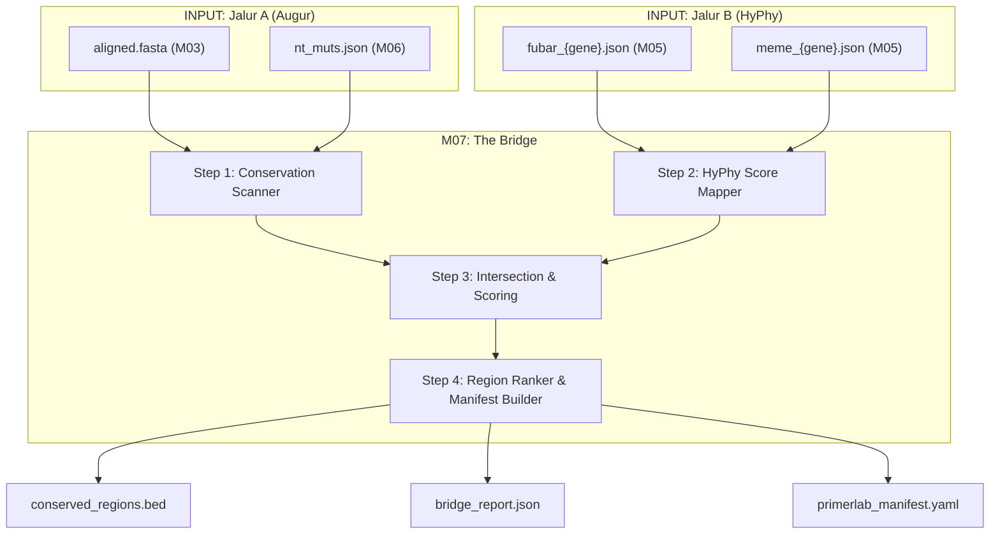

# M07 — The Bridge: Conservation & Selection Pressure Integrator

## Tujuan
Membangun **Modul 7 (M07)** yang bertugas sebagai "Mesin Pengambil Keputusan (Decision Engine)" — mengagregasi data evolusi dari seluruh pipeline ke dalam satu laporan koordinat akhir berisi **Zona Emas** (daerah conserved + seleksi negatif kuat).

> [!IMPORTANT]
> **Scope M07 berhenti di koordinat.** Modul ini HANYA bertanggung jawab menemukan dan merangking zona emas, lalu menyimpannya dalam format universal (BED, JSON, YAML). Tool pembuat primer apapun yang akan digunakan nanti (PrimerLab, Primer3 langsung, atau tool lain) adalah urusan modul selanjutnya.

## Konteks & Masalah yang Dipecahkan

Pipeline kita saat ini menghasilkan data dari **dua jalur** yang belum pernah bertemu:

| Jalur | Sumber | Data yang Dihasilkan | Lokasi File |
|-------|--------|---------------------|-------------|
| **A: Augur (M03-M06)** | MAFFT → IQ-TREE → Augur Ancestral/Translate | `nt_muts.json` (mutasi per cabang) & MSA `aligned.fasta` | `results/{BUILD}/m06/` & `m03/` |
| **B: HyPhy (M05)** | MACSE → FUBAR/MEME | `fubar_{gene}.json` & `meme_{gene}.json` (skor seleksi per kodon) | `results/{BUILD}/m05/` |

**Masalah:** Tidak ada satu pun modul yang menjawab pertanyaan kunci:
> *"Tunjukkan koordinat X sampai Y pada genom virus di mana (1) TIDAK ADA mutasi apapun yang terjadi lintas seluruh sampel, DAN (2) tekanan evolusi secara aktif MELARANG mutasi terjadi di sana."*

**M07 akan menjawab pertanyaan itu.**

---

## Arsitektur M07



---

## Logika Detail per Step

### Step 1: Conservation Scanner (Jalur A)
**Apa yang dilakukan:**
Membaca file `aligned.fasta` (MSA dari MAFFT) dan menghitung **Shannon Entropy** pada setiap posisi (kolom) dari alignment.

**Kenapa Shannon Entropy?**
Shannon Entropy ($H$) mengukur keragaman huruf pada satu posisi:
- $H = 0.0$ → Semua 223 sampel memiliki huruf yang **persis sama** di posisi itu (Sangat Conserved).
- $H > 0$ → Ada variasi/mutasi antar sampel di posisi itu.

**Langkah algoritma:**
1. Baca MSA, hitung entropy per kolom (mengabaikan gap `-` dan `N`).
2. Gunakan *sliding window* (default `150bp`, bisa diubah dari config) untuk menghitung **rata-rata entropy** dalam jendela tersebut.
3. Filter jendela yang memiliki rata-rata entropy **< threshold** (default `0.01`, artinya >99% conserved).
4. Gabungkan jendela-jendela yang berdekatan menjadi *merged regions*.
5. **Termasuk non-coding regions (5'UTR, 3'UTR)** — karena daerah ini juga bisa menjadi target primer yang valid. Zona UTR yang conserved akan ditandai `"hyphy_data": false` di laporan (hanya punya skor konservasi, tanpa skor evolusi).

**Output intermediat:** Array of `{chrom, start, end, mean_entropy, conservation_pct}`.

**Kenapa ini tidak cukup sendirian?**
Karena Conservation Scanner hanya tahu **masa lalu** (data historis dari sampel yang sudah dikumpulkan). Ia tidak tahu apakah daerah itu kebetulan belum bermutasi karena sampling yang rendah, atau memang secara evolusi DILARANG bermutasi. Di sinilah Step 2 masuk.

---

### Step 2: HyPhy Score Mapper (Jalur B)
**Apa yang dilakukan:**
Membaca output JSON dari FUBAR dan MEME untuk setiap gen, lalu memetakan skor seleksi per kodon kembali ke koordinat genom asli.

**Data yang diambil dari `fubar_{gene}.json`:**
Untuk setiap kodon, FUBAR mencatat:
- `alpha` (synonymous rate / laju mutasi diam)
- `beta` (non-synonymous rate / laju mutasi berbahaya)
- `Prob[alpha > beta]` → **Probabilitas Seleksi NEGATIF** (purifying). Semakin tinggi → semakin "dilarang bermutasi".
- `Prob[alpha < beta]` → Probabilitas Seleksi Positif (diversifying). Semakin tinggi → semakin "aktif bermutasi".

**Data yang diambil dari `meme_{gene}.json`:**
Untuk setiap kodon, MEME mencatat:
- `p-value` → Apakah ada bukti episodic positive selection. P-value kecil (< 0.05) = **Bahaya!** Mutasi sedang terjadi di sini secara aktif.

**Langkah algoritma:**
1. Parse setiap `fubar_{gene}.json` → ambil kolom `Prob[alpha > beta]` per kodon pada setiap gen.
2. Parse setiap `meme_{gene}.json` → ambil kolom `p-value` per kodon.
3. Konversi koordinat kodon lokal ke koordinat genom global menggunakan peta GFF (Gen S dimulai di posisi 21563, Gen N dimulai di posisi 28274, dst.).

**Output intermediat:** Array of `{genome_pos, gene, codon_idx, fubar_neg_prob, fubar_pos_prob, meme_pvalue}` untuk seluruh gen.

**Kenapa ini tidak cukup sendirian?**
Karena HyPhy hanya menganalisis gen yang dikodekan (coding regions). Ia tidak tahu apa-apa tentang daerah non-coding. Selain itu, skor dN/dS HyPhy adalah "prediksi evolusioner", bukan fakta lapangan. Menggabungkannya dengan fakta lapangan (Conservation Scanner) menghasilkan keyakinan **double-layer verification**.

---

### Step 3: Intersection & Composite Scoring
**Apa yang dilakukan:**
Menggabungkan hasil Step 1 dan Step 2 menjadi **skor komposit** per posisi.

**Formula Scoring:**
Untuk setiap daerah conserved yang lolos Step 1, hitung skor gabungan:

```
composite_score = w1 * (1 - mean_entropy) + w2 * avg_fubar_neg_prob + w3 * (1 - max_meme_danger)
```

Di mana:
- `w1 = 0.4` → Bobot untuk konservasi empiris (data lapangan)
- `w2 = 0.4` → Bobot untuk seleksi negatif HyPhy (prediksi evolusi)
- `w3 = 0.2` → Penalti untuk episodic selection MEME (anti-bahaya)
- `max_meme_danger` = proporsi kodon dalam jendela yang memiliki MEME p-value < 0.05

> [!IMPORTANT]
> Bobot `w1, w2, w3` ini akan bisa dikonfigurasi di `config.yaml` sehingga user bisa menyesuaikan prioritas menurut kebutuhan proyek (misalnya lebih mempercayai data lapangan vs prediksi evolusi).

**Fail-Safe Protocol (Bertingkat):**
Jika tidak ada daerah yang lolos Tier 1, sistem secara otomatis menurunkan persyaratan:
- **Tier 1 (Strict):** Conservation >99% DAN avg FUBAR purifying prob >0.9 DAN tidak ada MEME episodic signal. *(Ideal untuk primer universal)*
- **Tier 2 (Moderate):** Conservation >95% DAN avg FUBAR purifying prob >0.7. *(Cukup baik)*
- **Tier 3 (Survival):** Conservation >90%, abaikan filter HyPhy. *(Masih bisa dipakai jika data evolusi terlalu sedikit)*

---

### Step 4: Region Ranker & Output Builder
**Apa yang dilakukan:**
Mengurutkan semua Zona Emas berdasarkan `composite_score` (tertinggi = terbaik), lalu menghasilkan 3 file output.

#### Output 1: `conserved_regions.bed`
Format BED standar yang bisa divisualisasikan di IGV atau genome browser:
```
MN908947.3	28500	28750	N_region_1	0.95	+
MN908947.3	26300	26470	E_region_1	0.92	+
```

#### Output 2: `bridge_report.json`
Laporan komprehensif berisi:
```json
{
  "pipeline_version": "1.0",
  "total_conserved_regions": 12,
  "tier_1_regions": 5,
  "tier_2_regions": 4,
  "tier_3_regions": 3,
  "regions": [
    {
      "rank": 1,
      "gene": "N",
      "start": 28500,
      "end": 28750,
      "length": 250,
      "conservation_pct": 99.8,
      "mean_entropy": 0.002,
      "avg_fubar_purifying_prob": 0.95,
      "meme_episodic_sites": 0,
      "composite_score": 0.97,
      "tier": 1,
      "recommendation": "EXCELLENT — Ideal for universal primer design"
    }
  ],
  "genes_analyzed": ["S", "N", "E", "M"],
  "total_sequences_in_msa": 223,
  "warnings": []
}
```

#### Output 3: `primer_targets_manifest.yaml`
File koordinat universal yang **tool-agnostic** (bisa dipakai oleh PrimerLab, Primer3 CLI, atau tool lain apapun):
```yaml
pipeline_run_id: "sars-cov-2-trial_bridge"
source: "pandemic-preparedness-m07"
reference_genome: "config/references/sars_cov_2_reference.fasta"
buffer_bp: 100  # Buffer di kiri/kanan zona emas

candidate_regions:
  - region_id: "N_region1"
    rank: 1
    gene: "N"
    tier: 1
    composite_score: 0.97
    conserved_zone:
      start: 28500
      end: 28750
      length: 250
    included_region:           # Zona emas + buffer untuk ruang gerak primer
      start: 28400             # conserved_start - buffer
      end: 28850               # conserved_end + buffer
      length: 450
    metrics:
      conservation_pct: 99.8
      mean_entropy: 0.002
      avg_fubar_purifying_prob: 0.95
      meme_episodic_sites: 0
      has_hyphy_data: true
    recommendation: "EXCELLENT — Ideal for universal primer design"

  - region_id: "E_region1"
    rank: 2
    gene: "E"
    tier: 1
    composite_score: 0.92
    conserved_zone:
      start: 26300
      end: 26470
      length: 170
    included_region:
      start: 26200
      end: 26570
      length: 370
    metrics:
      conservation_pct: 99.5
      mean_entropy: 0.004
      avg_fubar_purifying_prob: 0.91
      meme_episodic_sites: 0
      has_hyphy_data: true
    recommendation: "EXCELLENT — Small gene, very stable"

  - region_id: "5UTR_region1"
    rank: 8
    gene: "5'UTR"
    tier: 2
    composite_score: 0.78
    conserved_zone:
      start: 50
      end: 220
      length: 170
    included_region:
      start: 1
      end: 320
      length: 320
    metrics:
      conservation_pct: 97.2
      mean_entropy: 0.008
      has_hyphy_data: false     # Non-coding, no HyPhy data
    recommendation: "GOOD — Non-coding, conservation-only score"
```

> [!NOTE]
> Setiap region memiliki dua koordinat: `conserved_zone` (Zona Emas murni) dan `included_region` (Zona + buffer). Tool desain primer apapun nanti tinggal membaca `included_region` sebagai area kerja.

---

## Proposed Changes

### Pandemic Preparedness Pipeline

#### [NEW] [m07_bridge_builder.py](file:///e:/Project/pandemic-preparedness/scripts/m07_bridge_builder.py)
Script Python utama (~350 baris) yang menjalankan Step 1-4 dalam satu eksekusi. Menerima argumen:
- `--msa` → Path ke aligned.fasta
- `--gff` → Path ke annotation GFF
- `--hyphy-dir` → Direktori berisi fubar_*.json dan meme_*.json
- `--reference` → Path ke reference FASTA
- `--outdir` → Direktori output
- `--config` → Path ke config.yaml (untuk threshold & bobot)

---

#### [NEW] [m07_bridge.smk](file:///e:/Project/pandemic-preparedness/rules/m07_bridge.smk)
Snakemake rule baru yang menyambungkan M05 → M07. Berisi satu rule `m07_bridge` yang:
- **Input:** `aligned.fasta`, semua `fubar_*.json` dan `meme_*.json`, reference FASTA, GFF
- **Output:** `conserved_regions.bed`, `bridge_report.json`, `primer_targets_manifest.yaml`
- **Conda:** Menggunakan env `hyphy_macse.yaml` (sudah punya biopython + pandas)

---

#### [MODIFY] [Snakefile](file:///e:/Project/pandemic-preparedness/Snakefile)
- Menambahkan `include: "rules/m07_bridge.smk"`
- Menambahkan output M07 ke target `rule all`

---

#### [MODIFY] [config.yaml](file:///e:/Project/pandemic-preparedness/config/config.yaml)
Menambahkan section `bridge`:
```yaml
# 8. Bridge Configuration (M7 — Conservation & Selection Integration)
bridge:
  window_size: 150          # Sliding window size for conservation scan (bp)
  min_region_length: 100    # Minimum conserved region length to consider (bp)
  buffer_bp: 100            # Buffer around conserved zone for included_region
  entropy_threshold: 0.01   # Max Shannon entropy (0.01 = >99% conserved)
  include_utr: true         # Include 5'/3' UTR in conservation scan
  weights:
    conservation: 0.4       # Weight for empirical conservation
    purifying: 0.4          # Weight for HyPhy purifying selection
    episodic_penalty: 0.2   # Penalty weight for MEME episodic selection
  tiers:
    strict:
      min_conservation: 0.99
      min_purifying_prob: 0.9
    moderate:
      min_conservation: 0.95
      min_purifying_prob: 0.7
    survival:
      min_conservation: 0.90
```

---

## Bagaimana Hasil Ini Digunakan Kedepannya?

### Skenario 1: Input ke Tool Desain Primer (Apapun)
File `primer_targets_manifest.yaml` berisi semua koordinat zona emas beserta `included_region` (zona + buffer). Tool apapun nanti — baik PrimerLab, Primer3 CLI, atau tool custom — tinggal membaca field `included_region.start` dan `included_region.length` untuk membatasi area pencarian primer.

### Skenario 2: Visualisasi di Genome Browser
File `conserved_regions.bed` dapat langsung di-*drag-and-drop* ke **IGV** (Integrative Genomics Viewer) untuk melihat peta zona emas di atas genom virus secara visual.

### Skenario 3: Laporan Ilmiah
`bridge_report.json` berisi semua statistik yang bisa diekstrak untuk tabel dalam paper ilmiah atau laporan ke WHO.

### Skenario 4: Multi-Virus Scalability
Karena seluruh logika M07 berbasis GFF + MSA + HyPhy JSON (format universal), kamu bisa langsung mengganti referensi virus di `config.yaml` ke Influenza A atau RSV, dan M07 akan secara otomatis menemukan Zona Emas dari virus apapun tanpa perubahan kode.

---

## Verification Plan

### Automated Tests
```bash
# 1. Dry-run DAG check
snakemake -np

# 2. Full execution
snakemake --use-conda --cores 64

# 3. Verify outputs exist
ls -la results/sars-cov-2-trial/m07/
# Expected: conserved_regions.bed, bridge_report.json, primer_targets_manifest.yaml
```

### Manual Verification
- Buka `bridge_report.json` dan periksa apakah:
  1. Zona yang ditemukan masuk akal secara biologis (misalnya Gen N dan E dikenal conserved).
  2. Composite score tertinggi memang berada di daerah yang sudah terbukti conserved di literatur.
- *Opsional:* Buka `conserved_regions.bed` di IGV untuk visualisasi.

---

## Resolved Questions

| Q | Keputusan |
|---|---|
| Q1: UTR Scanning | ✅ Ikutkan. UTR akan di-scan oleh Conservation Scanner, ditandai `has_hyphy_data: false` |
| Q2: Format Output | ✅ Manifest batch tunggal (`primer_targets_manifest.yaml`). Tool-agnostic — tidak terikat PrimerLab |
| Q3: Bobot Scoring | ✅ Default `0.4 / 0.4 / 0.2`. Bisa diubah di config oleh user |
