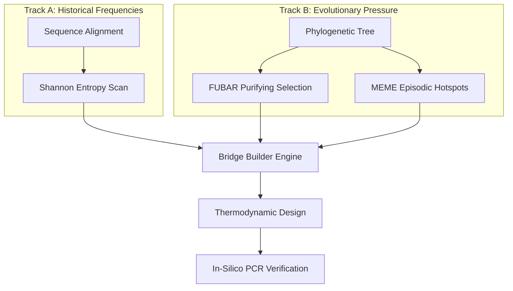

# Introduction

Welcome to the **Evolutionary Diagnostic Pipeline for Pandemic Preparedness** documentation. This pipeline identifies, grades, and validates robust molecular diagnostic targets (primers and probes) for emerging pathogens. 

By integrating **historical sequence conservation** with **evolutionary selection pressure models**, the pipeline designs assays that are highly resistant to future viral mutations, preventing diagnostic escape.

---

## Strategic Collaboration

This project is part of a national genomic surveillance and pandemic preparedness research initiative funded and led by:
- **National Research and Innovation Agency (BRIN)**, through the **Biomedical Research Center (PR Biomedis)**.
- **Universitas Gadjah Mada (UGM)**, Faculty of Biology.
- **Universitas Indonesia (UI)**.
- **International Partners**: University of Bern (Switzerland) and Tokyo University of Agriculture and Technology (Japan).

---

## Core Scientific Pillars

To protect assays against mutational drift (a primary cause of false-negative clinical results in RNA viruses), the pipeline implements three scientific pillars:

<CardGroup cols={2}>
  <Card title="Purifying Selection" icon="shield-halved">
    Calculates codon-level constraint via FUBAR. Target sites under strict purifying selection cannot mutate without reducing viral fitness, locking in target stability.
  </Card>
  <Card title="Episodic Evasion" icon="triangle-exclamation">
    Detects emerging mutational hotspots using MEME. Positional hotspots undergoing active selective sweeps are penalized and avoided.
  </Card>
  <Card title="Thermodynamics" icon="temperature-half">
    Models primer-dimer, hairpin, and cross-hybridization binding energies at target temperatures (e.g. 39°C for RAA, 55°C for PCR) using ViennaRNA.
  </Card>
  <Card title="Amplification Kinetics" icon="chart-line">
    Simulates in-silico PCR on surveillance sequences, enforcing strict 3' recombinase extension and probe THF endonuclease IV cleavage windows.
  </Card>
</CardGroup>

---

## Document Navigation

Get started with setting up and running your first target discovery task:

- **[Quickstart Guide](/getting-started/quickstart)**: Setup WSL2/Ubuntu, conda, and run a dry-run.
- **[Data Preparation](/getting-started/data-preparation)**: Ingest GISAID, NCBI Virus, or custom sequencing data.
- **[Pipeline Overview](/pipeline-architecture/overview)**: Learn about the 10 modules and their I/O data flow.
- **[Evolutionary Diagnostics](/concepts/evolutionary-diagnostics)**: Dive deep into the molecular biology theory.
