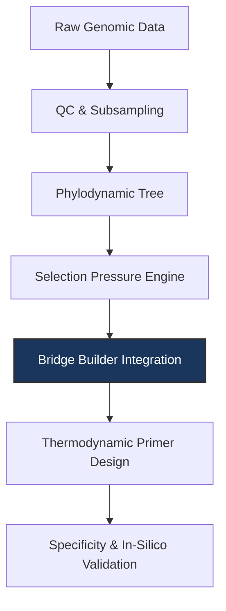

# Introduction

Welcome to the **Evolutionary Diagnostic Pipeline for Pandemic Preparedness** documentation. This site provides comprehensive guides, technical references, and contribution guidelines for our diagnostic target discovery system.

---

## Project Overview

This repository hosts a state-of-the-art bioinformatics pipeline designed for the rapid identification and validation of robust diagnostic targets in emerging pathogens. The core science integrates **physical sequence conservation** (Shannon Entropy) with **evolutionary selection pressure signals** (purifying vs. episodic selection) to identify regions of the viral genome that are biochemically stable and evolutionarily constrained.

---

## Strategic Collaboration

This project is part of a strategic research initiative funded and led by:
*   **National Research and Innovation Agency (BRIN)**, through the **Biomedical Research Center (PR Biomedis)**.
*   **Universitas Gadjah Mada (UGM)**, Faculty of Biology.
*   **Universitas Indonesia (UI)**.
*   **International Partners**: University of Bern (Switzerland) and Tokyo University of Agriculture and Technology (Japan).

---

## Scientific Rationale

Standard diagnostic designs (such as those targeting SARS-CoV-2 during early 2020) often fail when the virus mutates at the primer binding site. To prevent diagnostic escape, our pipeline is built on the following pillars:

1.  **Purifying Selection Identification**: Using codon-based evolutionary modeling (HyPhy FUBAR) to find positions where mutations are actively rejected by natural selection. Primers targeting these sites are highly resistant to future evolutionary shifts.
2.  **Episodic Selection Evasion**: Identifying genomic hot-spots undergoing temporary bursts of adaptive mutation (HyPhy MEME) and actively penalizing/avoiding them.
3.  **Thermodynamic Rigor**: Validating every designed primer and probe candidate using ViennaRNA secondary structure analysis to avoid hairpins, homodimers, and heterodimers at isothermal or PCR reaction temperatures.
