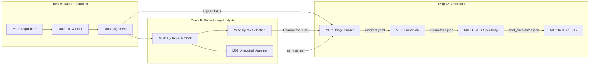

# Pipeline Architecture Overview

The pipeline is organized into ten discrete, modular steps (M01–M10), orchestrated by **Snakemake**. Each module has a dedicated Snakemake rule file, isolated conda environment, and produces versioned log files. The pipeline uses a **two-track architecture**: Track A processes genomic conservation signals; Track B processes evolutionary selection pressure signals. Both tracks converge at **M07 Bridge Builder**, which integrates them into a composite scoring framework for diagnostic assay design.

---

## High-Level Data Flow



---

## Module I/O Reference

The table below shows the primary input and output for each module and which modules depend on it.

| Module | Primary Input(s) | Primary Output(s) | Consumed By |
|---|---|---|---|
| **M01** Acquisition & Standardisation | Raw FASTA + metadata (GISAID/NCBI) | `raw_sequences.fasta`, `metadata_enriched.tsv` | M02, M05, M07, M10 |
| **M02** QC & Subsampling | `raw_sequences.fasta`, `metadata_enriched.tsv` | `filtered_sequences.fasta` | M03 |
| **M03** Alignment | `filtered_sequences.fasta`, reference FASTA | `aligned.fasta` | M04, M05, M06, M07 |
| **M04** Phylogenetics | `aligned.fasta`, `metadata_enriched.tsv` | `tree.nwk`, `branch_lengths.json` | M05, M06 |
| **M05** Selection Analysis | `aligned.fasta`, `tree.nwk`, GFF3 | `fubar_{GENE}.json`, `meme_{GENE}.json` | M07 |
| **M06** Ancestral Reconstruction | `tree.nwk`, `aligned.fasta`, GFF3 | `nt_muts.json`, `aa_muts.json`, `auspice_dataset.json` | M07 |
| **M07** Bridge Builder *(checkpoint)* | `aligned.fasta`, FUBAR/MEME/GARD JSONs, `nt_muts.json` | `bridge_report.json`, `primer_targets_manifest.yaml`, `conserved_regions.bed` | M08, M09, M10 |
| **M08** PrimerLab | `primer_targets_manifest.yaml`, PrimerLab template | `alternatives.json`, `summary.json` per region | M09 |
| **M09** BLAST Specificity | `alternatives.json`, `bridge_report.json` | `specificity_report_{ID}.md`, `final_candidates.json` | M10 |
| **M10** In-Silico PCR | `final_candidates.json`, full sequence FASTA | `coverage_summary.tsv`, `coverage_report.md`, `coverage_heatmap.html` | — (terminal output) |

> [!NOTE]
> M07 is declared as a Snakemake **`checkpoint`**. This means Snakemake re-evaluates the downstream DAG after M07 completes, because the number of candidate regions (and therefore M08/M09/M10 job instances) is unknown until the Bridge Builder manifest is written. Avoid running M08–M10 rules directly without first ensuring M07 has completed successfully.

---

## Conda Environments

Each module uses an isolated conda environment to prevent dependency conflicts between tools with incompatible requirements:

| Environment | File | Modules | Key Tools |
|---|---|---|---|
| `nextstrain` | `envs/nextstrain.yaml` | M01–M04, M06 | `augur`, `nextclade`, `mafft`, `iqtree`, `treetime`, `ncbi-datasets-cli` |
| `hyphy_macse` | `envs/hyphy_macse.yaml` | M05, M07 | `hyphy`, `macse`, `biopython`, `pandas`, `pyyaml` |
| `primerlab` | `envs/primerlab.yaml` | M08, M09 | `primerlab-genomic`, `blast+`, `viennarna`, `primer3-py` |
| `m10_insilico` | `envs/m10_insilico.yaml` | M10 | `seqkit`, `pandas`, `plotly` |

---

## Directory Conventions

```
pandemic-preparedness/
├── Snakefile              # Entry point — imports rules, defines TARGET_GENES
├── config/                # YAML configuration profiles (one per pathogen/build)
├── rules/                 # Snakemake rule files (.smk), one per module group
├── scripts/               # Python scripts called by rules
├── envs/                  # Conda environment YAML files
├── resources/blast_db/    # Built-in-place local BLAST databases (gitignored)
├── docs/                  # Mintlify documentation source
└── results/{BUILD}/       # All pipeline outputs, segregated by build_name
    ├── m01/               # Acquisition outputs
    ├── m02/               # QC outputs
    ├── m03/               # Alignment outputs
    ├── m04/               # Phylogenetic tree outputs
    ├── m05/               # HyPhy selection outputs
    ├── m06/               # Ancestral reconstruction outputs
    ├── nextstrain/        # Auspice dataset (from M06)
    ├── m07/               # Bridge Builder outputs
    ├── m08/               # PrimerLab design outputs
    ├── m09/               # BLAST verification outputs
    └── m10/               # In-silico PCR validation outputs
```

All outputs are segregated by `build_name` — running the pipeline with a different `build_name` produces a completely independent result set, enabling parallel runs for multiple pathogen targets without file conflicts.

---

## Deferred Features (Future Phases)

The following capabilities are planned but not yet implemented:

| Feature | Module | Phase | Notes |
|---|---|---|---|
| Clade-defining SNP Finder | M05 | Phase 2 | Identifies mutations unique to each clade for Route B (clade-specific primers) |
| Protein phylogeny (WAG/LG models) | M04 | Phase 2 | For antigen/vaccine strain selection applications |
| SNP Matrix per subtype | M05 | Phase 2 | Required companion to Clade SNP Finder |
| GARD for Influenza (experimental) | M05 | — | Scientifically inappropriate for segmented viruses; DROPPED |

---

## Running the Pipeline

```bash
# Full run with conda environments
snakemake \
    --use-conda \
    --configfile config/config_influenza_a_mp.yaml \
    --cores 16 \
    --rerun-incomplete \
    2>&1 | tee logs/snakemake_run.log

# Dry-run (validate DAG without executing)
snakemake \
    --use-conda \
    --configfile config/config_influenza_a_mp.yaml \
    --dryrun --printshellcmds
```

See [Monitoring & Run Management](/operations/monitoring) for HPC execution, checkpoint handling, and failure recovery.
