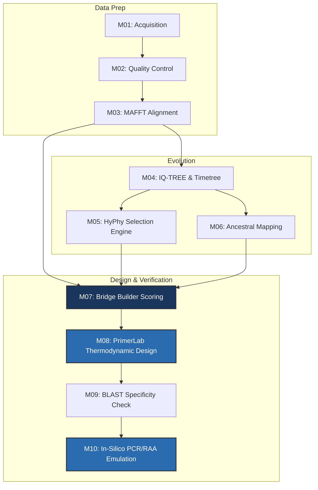

# Pipeline Architecture Overview

The pipeline is organized into ten distinct, modular steps (M01 to M10), orchestrated via **Snakemake**. Each module has dedicated Conda environment files and outputs structured logs.

---

## High-Level Data Flow

The diagram below outlines how genomic data and selection scores flow from raw sequences to validated diagnostic assays:

---

## Directory Conventions

A standardized folder structure is maintained to ensure that the workflow remains modular and reproducible:

*   [`rules/`](file:///e:/Project/pandemic-preparedness/rules/): Snakemake rule files containing logic definitions (e.g., `rules/m01_acquisition.smk`).
*   [`scripts/`](file:///e:/Project/pandemic-preparedness/scripts/): Executable Python and bash scripts called by rules.
*   [`envs/`](file:///e:/Project/pandemic-preparedness/envs/): Conda environment definition YAML files, specifying package versions for replication.
*   [`config/`](file:///e:/Project/pandemic-preparedness/config/): Pathogen YAML profiles.
*   [`results/`](file:///e:/Project/pandemic-preparedness/results/): Output directory, segregated by `build_name` to prevent collisions.
