# 🔍 Pipeline Audit Report: M1-M6 Pre-Run Review

**Date**: 2 April 2026  
**Status**: ✅ All Issues Resolved & Pushed

---

## Temuan Audit & Perbaikan

Aku menemukan **6 masalah** yang jika tidak diperbaiki akan menyebabkan kegagalan saat runtime. Semua sudah diperbaiki dan di-push.

### 🔴 CRITICAL (Pasti Error)

| # | File | Masalah | Perbaikan |
|---|------|---------|-----------|
| 1 | `Snakefile` | `rule all` meminta file `results/{BUILD}/nextstrain/aligned.fasta` yang **tidak diproduksi oleh rule manapun**. File `aligned.fasta` ada di `m03/`, bukan `nextstrain/`. Snakemake pasti akan gagal dengan `MissingRuleException`. | Dihapus dari target. Cukup `auspice_dataset.json` saja sebagai final target. |
| 2 | `m01_acquisition.smk` | Command `datasets download virus name` adalah **sintaks lama** NCBI Datasets CLI. Versi terbaru menggunakan `datasets download virus genome taxon`. | Diubah ke `datasets download virus genome taxon`. |
| 3 | `m01_acquisition.smk` & `m02_m06_augur_core.smk` | **Tidak ada `conda:` directive** di satupun rule. Tanpa ini, flag `--use-conda` dari Snakemake tidak akan pernah membangun environment dari `nextstrain.yaml`, dan semua tool (`augur`, `datasets`, `iqtree`) tidak akan ditemukan. | Ditambahkan `conda: "../envs/nextstrain.yaml"` ke semua 8 rule. |

### 🟡 HIGH (Kemungkinan Besar Error di Environment Bersih)

| # | File | Masalah | Perbaikan |
|---|------|---------|-----------|
| 4 | Semua `.smk` | Tidak ada `mkdir -p` untuk direktori output. Pada *fresh run*, direktori seperti `results/sars-cov-2-trial/m02/` belum ada sehingga perintah shell akan gagal menulis file. | Ditambahkan `mkdir -p` di awal setiap shell block yang menulis ke folder baru. |
| 5 | `m01_acquisition.smk` | `rm {params.zip_file}` akan **error** jika download gagal (file tidak ada). Dan `unzip` tanpa `-o` flag bisa prompt interaktif. | Diubah ke `rm -f` (force, no error) dan `unzip -o -p` (overwrite, pipe). |

### 🟢 ENHANCEMENT (Diperbaiki untuk Kelengkapan)

| # | File | Masalah | Perbaikan |
|---|------|---------|-----------|
| 6 | `m02_m06_augur_core.smk` | `augur export v2` tanpa `--title` menghasilkan dataset tanpa judul di Auspice viewer. | Ditambahkan `--title "Pandemic Preparedness: {params.build_name}"`. |

---

## Verifikasi CLI Flags vs Dokumentasi Augur v33.0.1

Aku sudah melakukan cross-check menyeluruh terhadap **semua flag CLI** yang kita gunakan dengan dokumentasi resmi Augur v33.0.1:

| Command | Flag Kita | Status | Catatan |
|---------|-----------|--------|---------|
| `augur filter` | `--output-sequences` | ✅ Valid | Sudah diupdate dari `--output` (deprecated) |
| `augur filter` | `--group-by`, `--sequences-per-group`, `--subsample-max-sequences`, `--min-length` | ✅ Valid | |
| `augur align` | `--sequences`, `--reference-sequence`, `--output`, `--fill-gaps`, `--nthreads` | ✅ Valid | |
| `augur tree` | `--alignment`, `--output`, `--method iqtree`, `--nthreads` | ✅ Valid | |
| `augur refine` | `--output-tree`, `--output-node-data`, `--timetree`, `--clock-rate`, `--clock-std-dev` | ✅ Valid | |
| `augur ancestral` | `--tree`, `--alignment`, `--output-node-data`, `--inference joint` | ✅ Valid | Default inference sudah `joint`, tapi explicit is better |
| `augur translate` | `--tree`, `--ancestral-sequences`, `--reference-sequence`, `--output-node-data` | ✅ Valid | |
| `augur export v2` | `--tree`, `--metadata`, `--node-data`, `--output`, `--title`, `--build-url` | ✅ Valid | |

---

## ⚠️ Pre-Requisite Sebelum Run

Ada **satu hal** yang perlu kamu siapkan secara manual sebelum menjalankan pipeline:

> [!IMPORTANT]
> **File Referensi Belum Ada!**
> 
> Config mengacu ke dua file yang belum ada di repository:
> - `config/references/sars_cov_2_reference.fasta` (Genome referensi, biasanya Wuhan-Hu-1 / MN908947.3)
> - `config/references/sars_cov_2_annotation.gff` (Anotasi gen/CDS)
> 
> Kamu bisa download dari NCBI:
> ```bash
> mkdir -p config/references
> # Download Wuhan-Hu-1 reference genome
> datasets download virus genome accession MN908947.3 --filename ref.zip
> unzip ref.zip -d ref_tmp
> cp ref_tmp/ncbi_dataset/data/genomic.fna config/references/sars_cov_2_reference.fasta
> rm -rf ref.zip ref_tmp
> ```
> Untuk file GFF, download dari: https://www.ncbi.nlm.nih.gov/nuccore/MN908947.3 → Send to → File → GFF3

---

## Data Flow Diagram (Post-Audit)

```mermaid
graph LR
    A["NCBI GenBank"] -->|datasets download| B["m01/raw_sequences.fasta<br/>m01/raw_metadata.jsonl"]
    B -->|Python json parse| C["m01/metadata.tsv"]
    B --> D["augur filter"]
    C --> D
    D --> E["m02/filtered_sequences.fasta"]
    E --> F["augur align"]
    REF["config/references/*.fasta"] --> F
    F --> G["m03/aligned.fasta"]
    G --> H["augur tree (iqtree)"]
    H --> I["m04/tree_raw.nwk"]
    I --> J["augur refine"]
    G --> J
    C --> J
    J --> K["m04/tree.nwk<br/>m04/branch_lengths.json"]
    K --> L["augur ancestral"]
    G --> L
    L --> M["m06/nt_muts.json"]
    M --> N["augur translate"]
    K --> N
    GFF["config/references/*.gff"] --> N
    N --> O["m06/aa_muts.json"]
    K --> P["augur export v2"]
    C --> P
    M --> P
    O --> P
    P --> Q["nextstrain/auspice_dataset.json"]
    
    style Q fill:#22c55e,color:#000
    style REF fill:#f59e0b,color:#000
    style GFF fill:#f59e0b,color:#000
```



---

## Perintah Run (Updated)

```bash
# Dari dalam WSL atau SSH ke HPC
cd /path/to/pandemic-preparedness

# Pastikan reference files sudah ada
ls config/references/

# Dry-run dulu
snakemake -n --use-conda

# Full run
snakemake --use-conda --cores 8
```
