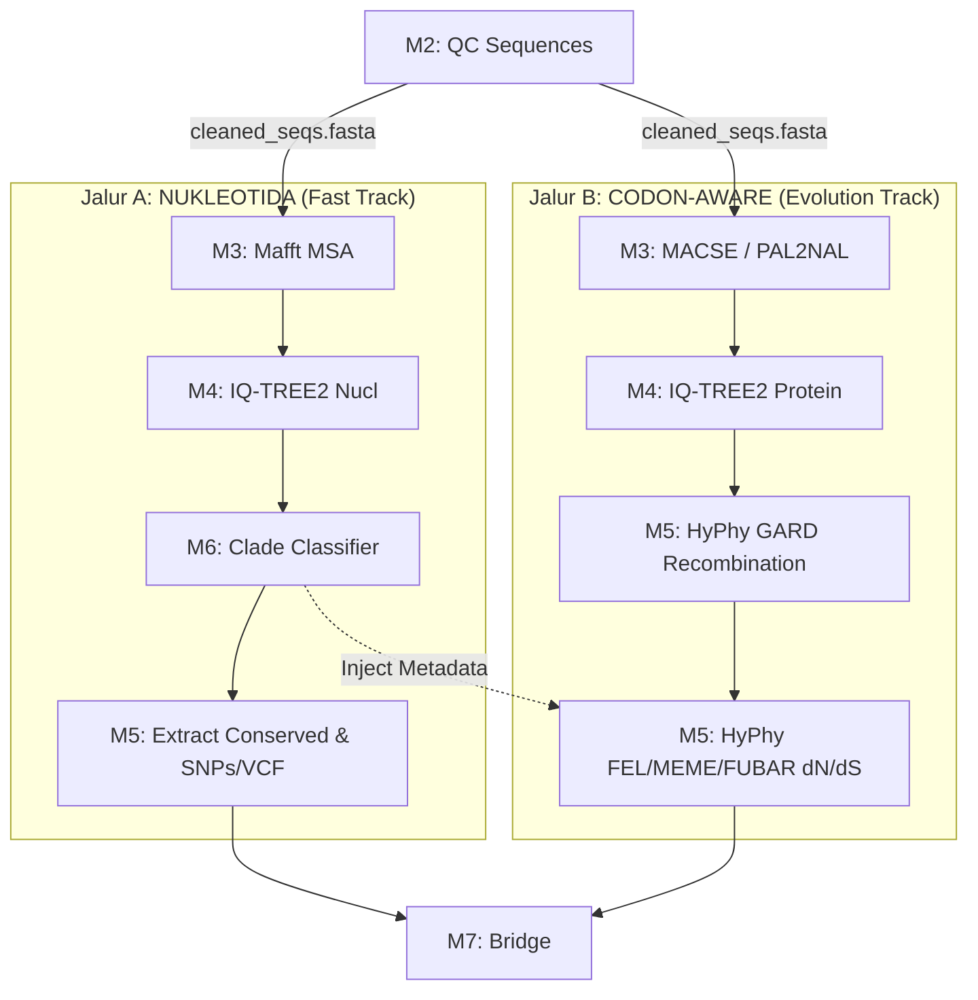

# 🧬 Stage 2: Bioinformatic Analysis & Evolution — Detailed Plan

> **Scope:** Module 3 (MSA), Module 4 (Phylogeny), Module 6 (Clade Classification)**, dan Module 5 (Sequence & Evolutionary Analysis).
> **Objective:** Menyejajarkan (align) sekuens, membangun pohon evolusi, mengklasifikasi varian/clade, lalu mengekstrak "Koordinat Emas" (daerah *conserved* & mutasi spesifik) serta menghitung tekanan seleksi alam (dN/dS).

---

## 1. Arsitektur Dua Jalur (Bifurcated Track)

Analisis downstream kita memiliki **dua tujuan utama yang bertolak belakang**:

1. Tujuan A: **Desain Primer PCR** → Butuh data nukleotida asli secepat mungkin.
2. Tujuan B: **Analisis Evolusi & Fungsi** → Butuh data kodon/protein yang hati-hati agar mutasi diam (*silent mutation*) tidak mengecoh.

Maka, mulai dari Module 3, pipeline kita akan membelah diri menjadi **Jalur A (Nukleotida)** dan **Jalur B (Codon/Protein)**.

### Master Flowchart Stage 2

---

## 2. Module 3: Multiple Sequence Alignment (M3)

### 2.1 M3-A: Jalur Nukleotida (MAFFT)

- **Goal:** Menghasilkan DNA alignment yang akurat secepat mungkin, meskipun ada mutasi *frameshift* (indel yang merusak pembacaan protein). Karena primer PCR tidak peduli asam amino, dia cuma butuh nempel di basa ACGT yang tepat.
- **Tools:** `MAFFT` (dengan `--auto` atau `--fft` option untuk paralel CPU).
- **Output:** `results/m03_msa_nucl/{target}/nucl_aligned.fasta`

### 2.2 M3-B: Jalur Codon-Aware (MACSE)

- **Goal:** Menghasilkan alignment RNA/DNA yang *sangat peka terhadap penerjemahan kodon (3-basa)*. Jika ada sisipan 1 basa (indel), *frameshift* dikendalikan agar asam amino di hilirnya tetap disejajarkan dengan benar.
- **Tools:** `MACSE` (v2.x) atau kombinasi `MAFFT` + `PAL2NAL`.
- **Output:**
  - `results/m03_msa_codon/{target}/codon_aligned_nucl.fasta`
  - `results/m03_msa_codon/{target}/codon_aligned_prot.fasta`

---

## 3. Module 4 & 6: Phylogeny & Clades (M4 & M6)

*Catatan M5 vs M6: Untuk mengetahui mutasi mana yang "ciri khas varian Alpha", kita harus tahu dulu mana sekuens yang termasuk Alpha. Jadi M6 jalan dulu.*

### 3.1 M4: Tree Reconstruction (IQ-TREE2)

- **Tools:** `IQ-TREE2`.
- **Feature Utama:**
  - `ModelFinder` (Otomatis mencari model evolusi terbaik, misal GTR+F+I+G4).
  - `Ultrafast Bootstrap (UFBoot)` untuk kecepatan validasi cabang.
- **Jalur A:** Pohon berbasis mutasi nukleotida (`tree_nucl.nwk`).
- **Jalur B:** Pohon berbasis mutasi asam amino (`tree_prot.nwk`).

### 3.2 M6: Clade Classification (Nextclade / Custom)

- **Goal:** Melabeli ribuan cabang di pohon tadi ke dalam *clade* / varian yang rapi.
- **Pendekatan (Bisa di-MIx):**
  1. **Auto (Nextclade/Pangolin):** Jika database tersedia, hasilkan `auto_clade` (misal: "21J", "21K").
  2. **Custom / Megaclade Mapping:** User bisa memberikan file CSV `clade_mapping.csv` di config (misal: Jika `auto_clade` == 21J atau 21K, maka `custom_clade` = "Megaclade_Delta"). Pipeline akan menggabungkan keduanya menjadi satu metadata raksasa (`metadata_with_clades.tsv`).
  3. **Custom Tree-Cutter:** Jika auto gagal/tidak ada, memotong pohon IQ-TREE2 secara algoritmik untuk membentuk grup kasar ("Clade 1", "Clade 2").
- **Output:** `results/m06_clade/{target}/metadata_with_clades.tsv`

---

## 4. Module 5: Sequence Analysis (M5)

Terbagi menjadi Analisis Fisik (A) dan Evolusi (B).

### 4.1 M5-A: Target Extraction (Nukleotida)

Menganalisis hasil MSA Jalur A digabung dengan metadata Clade dari M6.

- **1. Conserved Target Finder:**
  - *Logic:* Mencari blok jendela (`window_size` dari config, default `150bp` untuk mengakomodir Fwd+Probe+Rev) dengan keragaman `<0.1%` Shannon Entropy.
  - *Output:* `conserved_regions.bed` (Bed-file berisi koordinat pasti. Akan dipakai PrimerLab dengan constraint `SEQUENCE_INCLUDED_REGION` untuk primer Universal).
- **2. Clade-Defining SNP Finder:**
  - *Logic:* "Position 23012 ini selalu 'A' di Clade Delta, tapi 'G' di clade lain."
  - *Output:* `clade_snps.tsv` (Format VCF/TSV sederhana. Akan dipakai PrimerLab dengan constraint `SEQUENCE_TARGET` untuk Primer Spesifik Varian).

### 4.2 M5-B: Evolutionary Target Scoring (Codon/Protein)

Menggunakan paket `HyPhy` pada data dari Jalur B.

- **1. Recombination Detection (`GARD`):**
  - *Logic:* Apakah virus ini hasil gabung dari dua pohon silsilah berbeda (rekomunikasi)? GARD akan mencari titik potongnya (*breakpoint*).
  - *Why?* Karena Pohon Evolusi (M4) HARUS dibelah dua jika ada rekombinasi, kalau tidak hitungan dN/dS kacau.
- **2. Selection Pressure (`FUBAR` / `FEL` / `MEME`):**
  - *Logic:* Menghitung rasio $d_N/d_S$ (mutasi mengubah asam amino vs mutasi diam mutlak) pada setiap *codon site*.
  - *Why?* Titik dN/dS sangat tinggi = Menghindar dari antibodi (Bad for Primer). Titik dN/dS sangat rendah = Mempertahankan nyawa virus (Perfect for Primer).
  - *Models:*
    - **FUBAR:** Cepat, untuk mendeteksi seleksi konstan (pervasive) pada dataset besar.
    - **FEL:** Lebih lambat tapi statistik klasik untuk pervasive selection.
    - **MEME:** Eksklusif untuk mendeteksi mutasi ganas sesaat (*Episodic Selection*) pada *clade* tertentu (menggunakan metadata dari M6A).
  - *Output:* `dnds_scores.json` atau `dnds_scores.csv`.

---

## 5. Summary Flow to Bridge (M7)

Pada akhirnya, Modul 7 (Bridge) kita hanya akan menelan tiga output krusial dari Stage 2 ini:

1. `conserved_regions.bed` (Dari mana sampai mana Primer BISA nempel).
2. `clade_snps.tsv` (Titik mana saja yang HARUS dideteksi untuk varian tertentu).
3. `dnds_scores.csv` (Ranking tambahan: Dari semua wilayah yang *conserved*, berikan bobot tertinggi pada yang punya dN/dS paling rendah).

Modul 7 akan menerjemahkan ketiga ini menjadi sintaks rahasia PrimerLab:
`SEQUENCE_INCLUDED_REGION=15000,500` (Universal)
`SEQUENCE_TARGET=23012,1` (Clade Spesifik)

---

## 6. Execution Checklist (Stage 2)

- [ ] Evaluasi dependensi Mamba (IQ-TREE2, MAFFT, MACSE, HyPhy, Nextclade).
- [ ] Implementasikan Rule Snakemake untuk MAFFT dan MACSE.
- [ ] Implementasikan Script Python untuk *Conserved Region Finder* (`m05a_conserved_finder.py`).
- [ ] Implementasikan Script Python untuk SNP Extractor menggunakan Numpy/Pandas (`m05a_snp_extractor.py`).
- [ ] Integrasikan `HyPhy FEL` command-line di Snakemake rule M5-B.
- [ ] Rancang format *output* agregasi M5 yang siap dikonsumsi oleh M7.
