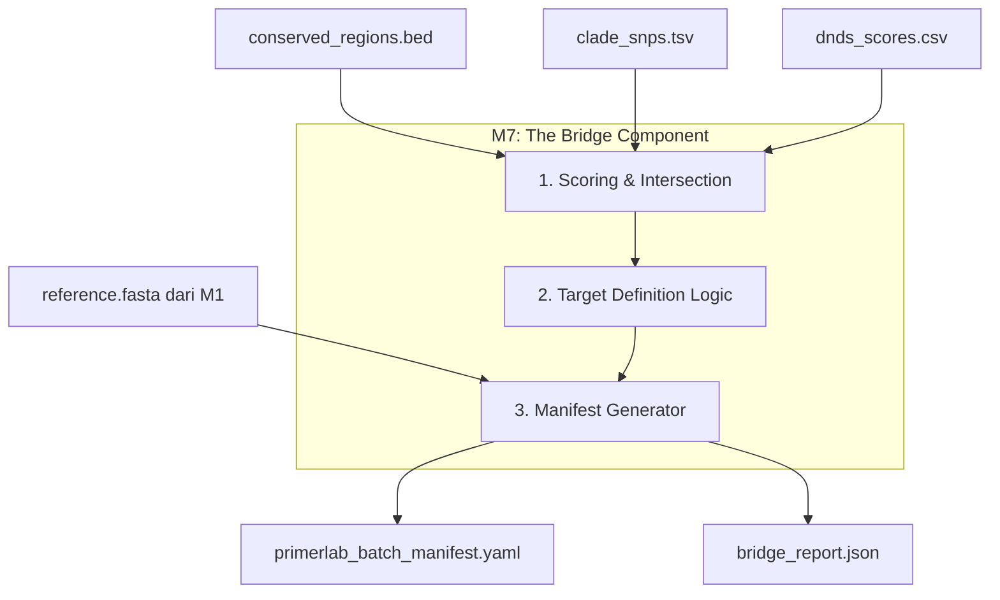

# 🌉 Stage 3: The Bridge — Detailed Plan

> **Scope:** Module 7 (Pipeline-to-PrimerLab Bridge)
> **Objective:** Mengubah data mentah statistika evolusi dan petaan mutasi (dari M5) menjadi set instruksi/manifest (*batch job*) yang bisa dieksekusi oleh PrimerLab.

---

## 1. Konsep & Tantangan Utama Modul 7

Di Stage 2, Modul 5 (M5) menghasilkan daftar posisi DNA yang menarik (daerah yang conserved, SNP penanda clade, dan skor dN/dS per basa). 

Namun, PrimerLab (M8) **tidak mengerti** apa itu dN/dS atau apa itu "Clade Delta". PrimerLab hanya mengerti urutan nukleotida dan batasan termodinamika (Tm, GC%, jarak amplikon).

Maka, Modul 7 (M7) bertindak sebagai **Penerjemah dan Mesin Pengambil Keputusan (Decision Engine)**. Tugasnya meranking data biologi tersebut dan membentuk peluru instruksi yang akan ditembakkan ke PrimerLab.

### Flowchart Modul 7



---

## 2. Logic Internal "M7 Decision Engine"

Skrip utama di M7 (misalnya `scripts/m07_bridge_builder.py`) akan menjalankan dua rute pembuatan target:

### 2.1 Rute A: Desain Target Universal (Anti-Bocor)
Tujuan: Membuat desain PCR yang mendeteksi **semua** varian/clade virus dengan peluang mutasi masa depan paling kecil.

**Logika Pemrosesan M7:**
1. **Intersection:** M7 mengambil daftar daerah conserved (dari `.bed`).
2. **Overlay dN/dS:** M7 memeriksa skor dN/dS dari titik tersebut.
3. **Filtering:** Jika daerah conserved itu ternyata punya dN/dS yang tinggi (artinya mutasi diam sangat kencang, rentan berubah di masa depan), daerah itu dibuang dari kandidat panjang PCR.
4. **Instruksi PrimerLab:** Sisa daerah "Emas" yang lolos (misal sepanjang 200bp) akan diterjemahkan menjadi instruksi: `SEQUENCE_INCLUDED_REGION=start,length`.

### 2.2 Rute B: Desain Target Spesifik Clade (Genotyping)
Tujuan: Membuat kit diagnostik yang bisa membedakan Pasien A kena Varian Alpha, Pasien B kena Varian Delta.

**Logika Pemrosesan M7:**
1. M7 mengambil daftar mutasi pembeda dari `clade_snps.tsv` (misal: SNP di posisi 23.012 menandakan Delta).
2. M7 menarik urutan FASTA *reference genome* di sekitar SNP tersebut (misal: 100bp ke kiri dan 100bp ke kanan).
3. **Instruksi PrimerLab:** M7 akan menerjemahkan posisi mutasi tersebut menjadi instruksi wajib jepit: `SEQUENCE_TARGET=23012,1` (Memaksa agar pasangan primer mengapit titik mutasi tersebut agar dapat diamplifikasi dan dideteksi via *probe* spesifik mutasi).

### 2.3 Rute Khusus Multiplex RT-LAMP (Aturan Jendela & Fail-Safe)
Karena desain 1 set RT-LAMP (6 primer) membutuhkan bentang sekuens yang panjang (~250-350 bp) dan kita mendesain Multiplex Panel (beberapa target sekaligus), M7 menerapkan aturan ekstra yang ketat namun toleran:

1. **Syarat Threshold Bertingkat (Fail-Safe Protocol):**
   - **Tier 1 (Strict):** *Conservation* > 99% DAN *dN/dS* < 0.1. (Ideal).
   - **Tier 2 (Moderate):** Jika Tier 1 kosong, maka turunkan threshold: *Conservation* > 95% DAN *dN/dS* < 0.5.
   - **Tier 3 (Survival):** Jika masih kosong, singkirkan filter dN/dS, cari area *Nucleotide Conservation* terbaik yang tersisa.
2. **Panjang Jendela Minimum:** M7 **wajib menolak** area conserve yang panjangnya di bawah 300 base-pairs. Area tersebut tidak akan cukup untuk diduduki 6 primer LAMP tanpa tabrakan. Hanya area $\ge$ 300 bp yang diteruskan.
3. **Penyimpanan Kandidat Ganda (Combinatorial Fallback):** Jika algoritma M7 menemukan 5 wilayah bagus yang memenuhi syarat Tier 1 & 300bp, kelimanya **tidak ada yang dibuang**. Kelimanya dikirim ke PrimerLab sebagai *Candidate Regions*, agar PrimerLab dapat melakukan *trial-and-error* / pencocokan kombinasi saat menguji potensi *hetero-dimer* antar-virus di multiplex.

---

## 3. Skema Output (Batch Manifest)

Output revolusioner dari M7 adalah merealisasikan fitur **Batch Processing** di PrimerLab (yang saat ini belum ada di platform PrimerLab milikmu).

Output final M7 adalah `primerlab_batch_manifest.yaml` yang berisi puluhan "misi" sekaligus.

**Contoh Format `primerlab_batch_manifest.yaml` (Multiplex RT-LAMP):**
```yaml
pipeline_run_id: "mux_resp_panel_2024"
workflows:
  default_type: "rt-lamp"

jobs:
  # Misi 1: RT-LAMP Orf1ab (SARS-CoV-2)
  - job_id: "lamp_sc2_orf1ab"
    target_file: "../../m01_acquisition/sarscov2_panel/raw_sequences.fasta"
    target_description: "Highly conserved region SARS-CoV-2 (dN/dS < 0.1)"
    primer3_constraints:
      SEQUENCE_INCLUDED_REGION: [15000, 300]  # Jendela 300bp untuk 6 primer LAMP

  # Misi 2: RT-LAMP HA Gene (Flu A H1N1)
  - job_id: "lamp_flua_ha"
    target_file: "../../m01_acquisition/flu_a_panel/raw_sequences.fasta"
    target_description: "Conserved stem region of HA"
    primer3_constraints:
      SEQUENCE_INCLUDED_REGION: [800, 300]

  # Misi 3: RT-LAMP M Gene (Flu B)
  - job_id: "lamp_flub_m"
    target_file: "../../m01_acquisition/flu_b_panel/raw_sequences.fasta"
    primer3_constraints:
      SEQUENCE_INCLUDED_REGION: [200, 300]
```

---

## 4. Execution Checklist (Stage 3)

Jika plan Stage 3 ini disetujui, berikut langkah eksekusinya:

- [ ] Merancang algoritma *Scoring Matrix* di `m07_bridge_builder.py` untuk mengawinkan data BED dan CSV statistika.
- [ ] Menyepakati skema final `batch_manifest.yaml` (agar *engine* PrimerLab di Stage 4 bisa mem-parsingnya dengan mudah).
- [ ] Membuat Snakemake Rule `m07_bridge` yang membutuhkan output agregat dari seluruh proses komputasi M5.
- [ ] Meng-implementasi Log Validation (`bridge_report.json`) untuk mendeteksi anomali (misal: tidak ada *conserved region* yang selamat dari filter dN/dS).
