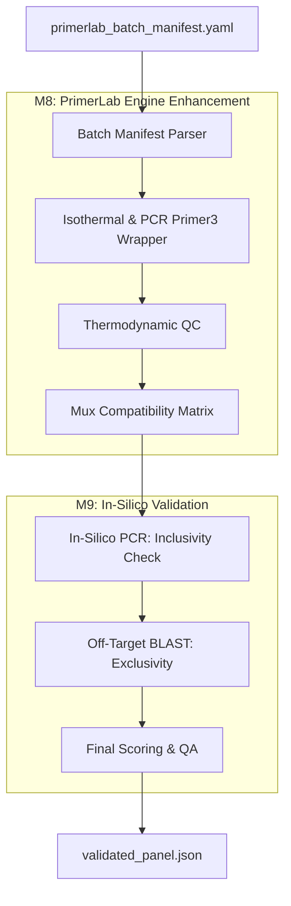

# 🌉 Stage 4: Diagnostic Engine & Validation (PrimerLab)

> **Scope:** Module 8 (Primer Design Engine) & Module 9 (In-Silico Validation)
> **Objective:** Merombak *engine* PrimerLab agar mendukung eksekusi *batch headless*, mendesain panel isothermal (RT-LAMP & RT-RPA) yang kompeten, menyatukannya dalam satu tabung sakti *Multiplex*, serta mengujinya secara *in-silico* melawan genom manusia dan flora pernapasan.

---

## 1. Arsitektur & Transisi Modul 8 & 9

Modul 8 mendobrak kebiasaan PrimerLab yang tadinya bersifat "*Interactive CLI*". Kini, PrimerLab ditarik ke belakang layar menjadi **"Headless Engine"**.
Ia diorkestrasi oleh **Snakemake** dan digerakkan oleh satu *file command*: `primerlab_batch_manifest.yaml` (kiriman dari M7). Output dari M8 adalah desain kandidat primer multiplex, yang kemudian **wajib** lolos ujian ketat lintas alam (BLAST & In-Silico PCR) di Modul 9 (M9).

---

## 2. Modul 8 (M8): Major Enhancements on PrimerLab

Fitur-fitur raksasa ini harus diprogram (*hard-code*) ke dalam `primerlab-genomic`:

### 2.1 Batch Manifest Processing
PrimerLab tidak lagi menanyakan *"What do you want to do?"*. PrimerLab membaca file YAML dan langsung mendistribusikan ratusan instruksi (`job_id`) ke server Primer3 secara paralel.

### 2.2 Spatial Constraint Injection (`SEQUENCE_INCLUDED_REGION`)
Agar PrimerLab penurut dan **hanya mendesain di area hasil seleksi alam (dN/dS)**, kita harus menginjeksi parameter `SEQUENCE_INCLUDED_REGION` langsung ke dalam *core wrapper* Primer3 yang ada di PrimerLab. Area mutasi pembeda (untuk *clading*) diinjeksikan via `SEQUENCE_TARGET`.

### 2.3 Isothermal Target Modes (Senjata POCT)
PrimerLab harus berevolusi dari sebatas pembuat PCR konvensional menjadi pabrik Isothermal:
1. **Mode `rt-lamp` (Target Utama):**
   - **Logika:** Membutuhkan 6 primer presisi tinggi (F3, B3, FIP [F1c+F2], BIP [B1c+B2], LF, LB) yang menempati 8 wilayah persinggungan.
   - **Constraint:** Area harus besar ($\ge$ 300 bp). Jika algoritma mati-matian gagal menemukan 6 primer harmonis, **Fallback RT-LAMP (Core-4)** diaktifkan: Hanya mendesain 4 primer esensial (tanpa Loop LF/LB). Reaksi akan lebih lambat (60 vs 30 menit) tapi tetap sah sebagai *assay*.
2. **Mode `rt-rpa` (Opsi POCT Sekunder / Plan B):**
   - **Logika:** Amplifikasi menggunakan enzim Rekombinase (Recombinase Polymerase Amplification) pada suhu konstan (37-42°C). Modelnya mirip TaqMan tapi bentuk fisiknya berbeda.
   - **Constraint:** Syaratnya *Counter-intuitive*. Primer maju/mundurnya **sangat panjang** (30-35 bp), sedangkan *TwistAmp Probe*-nya lebih raksasa lagi (46-52 bp). PrimerLab harus memodifikasi syarat Tm (karena enzim beroperasi di suhu rendah) dan panjang sekuens. Mampu masuk ke area conserved yang lebih pendek dibanding LAMP (~150 bp).
3. **Mode `rt-qpcr` (Gold Standard Benchmark):**
   - Mode TaqMan yang ada saat ini tetap dipertahankan sebagai alat komparasi/validasi klinis (Raja Penguji). Karena target kita dalah virus RNA (Orthomyxovirus & Coronavirus), mode ini mutlak diawali proses Reverse-Transcription (RT-qPCR).

### 2.4 Multiplex Compatibility Matrix (N-Plex Heterodimer Engine)
Inilah nyawa *multiplexing*. Jika kita mencampur Reagen SC2, Flu A, dan Flu B dalam 1 tabung (masing-masing alat bawa 6 primer LAMP ➡️ 18 primer), **mereka rentan berikatan satu sama lain membentuk artefak beracun (*Heterodimers*)**.
- PrimerLab menerima "Top 5 Kandidat" (Fallbacks) per virus dari M7.
- PrimerLab "mengocok" kombinasi silang (contoh: SC2-Kandidat-A + FluA-Kandidat-C + FluB-Kandidat-A).
- Semua diumpankan ke **ViennaRNA / RNAcofold** untuk mengecek kestabilan ikatan dua lapis ($\Delta G$). Jika ikatan silang terlalu kuat (lebih stabil dari -9 kcal/mol), kombinasi itu **dimusnahkan**. Terus mengocok hingga ditemukan set keemasan.

---

## 3. Modul 9 (M9): In-Silico Validation (Ujian Klinis Komputasional)

Primer cantik di atas kertas tidak berguna jika salah mendeteksi di meja lab (reaktif silang dengan flora manusia).

### 3.1 In-Silico PCR (Inclusivity Check)
- **Tujuan:** Seberapa sensitif primer tersebut mendeteksi *semua* sub-varian virus yang menjadi target utamanya?
- **Proses:** Menjalankan algoritma `isPCR` / *fuzzy-matching* melawan ribuan sekuens genom dari varian terbaru (misal: Omicron JN.1). Jika primer tidak mampu menempel (karena mutasi di ujung 3' varian JN.1), skor inklusivitas turun drastis.

### 3.2 Off-Target BLAST (Exclusivity / Specificity Check)
- **Tujuan:** Seberapa paten primer tersebut dalam menghindari deteksi "hantu" (*False Positive*)?
- **Proses:** Modul 9 akan menembakkan (*blastn*) desain final kita melawan:
  1. **Genome Manusia (Human GRCh38 / GRCh37):** Memastikan primer tidak menggandakan sel pipi/hidung manusia. *(Databasenya sekitar ~4-5 GB termampatkan)*.
  2. **Microbiome / Respiratory Flora:** Melawan database jamur, bakteri paru normal, atau virus ISPA non-target. *(Database ini dipilah khusus agar footprint-nya di komputer HPC kita hanya ~15 GB)*.
- **Local BLAST vs Cloud (NCBI API):** Pipeline ini mewajibkan **Local BLAST** agar 100% *reproducible*, bisa dijalankan *offline*, dan selesai dalam hitungan detik tanpa hambatan limitasi *rate-limit* NCBI (yang bisa memakan waktu berjam-jam untuk file batch yang besar).

---

## 4. Output Custom (Di Luar PrimerLab)

Penting dicatat bahwa Modul 9 menelurkan file emas `validated_panel_report.json` dan `final_design_stats.csv`. Output ini **bukanlah** keluaran murni PrimerLab (M8). PrimerLab hanya menelurkan termodinamika mentah dan kombinasi matriks. 

M9 adalah hakim yang kita buat sendiri menggunakan Snakemake Python Script untuk menggabungkan skor termodinamika PrimerLab dengan laporan kelulusan *isPCR* dan *BLAST*. Data gabungan inilah yang siap divisualisasikan menjadi *Comprehensive Report* PDF di Stage 5 (M10).

---

## 5. Execution Checklist (Stage 4)

- [ ] Membedah `primerlab/api/public.py` untuk menyiapkan *endpoint* `design_rt_lamp`, `design_rt_rpa`, dan jalur validasi Multiplex.
- [ ] Memasukkan profil ukuran dan Tm RT-RPA ke *backend* Primer3.
- [ ] Menulis algoritma `Multiplex Matrix Reranker` yang sanggup me-looping *fallback combination* dari M7 tanpa menghabiskan RAM secara serampangan.
- [ ] Mendeploy Rule Snakemake `m08_primerlab_batch` dan `m09_insilico_validation`.
- [ ] Setup *Local BLAST DB* minimal untuk GRCh38 di HPC / Komputermu.
