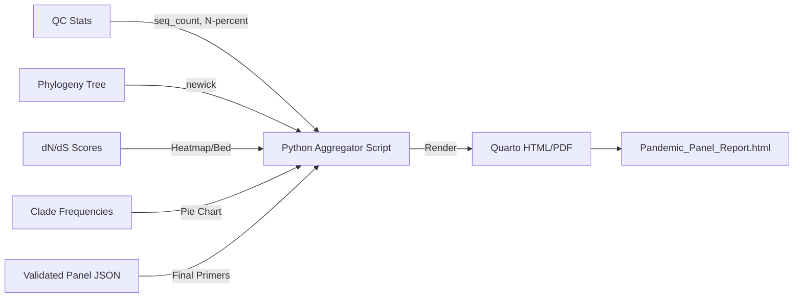

# 📊 Stage 5: The Comprehensive Report (Module 10)

> **Scope:** Module 10 (Reporting & Visualization)
> **Objective:** Merangkum seluruh perjalanan data (dari akuisisi genom, sejarah evolusi dN/dS, klasifikasi clade, desain multiplex RT-LAMP/RPA, hingga validasi klinis In-Silico) menjadi dokumen HTML/PDF interaktif standar industri (WHO/BRIN).

---

## 1. Konsep Pembuatan Laporan

Modul 10 (M10) adalah **Wajah dari Pipeline Ini**. Laporan ini *bukan* log eror komputasi, melainkan dokumen yang akan dibaca oleh *Principal Investigator*, Kemenkes, dan *Wet-Lab Scientist* sebelum mereka meracik reagen.

Laporan digenerate menggunakan **Quarto** (atau RMarkdown/Jupyter Notebook headless) yang difasilitasi oleh Snakemake sebagai langkah *final*.

### Architecture Flow (M10)

---

## 2. Struktur Konten Laporan (Apa Saja yang Ditampilkan?)

Laporan akan dibagi menjadi beberapa *Tab* atau bab utama:

### 2.1 Executive Summary (Dashboard)
- **Status Panel:** `[🟩 PASSED]` atau `[🟥 FAILED]`.
- **Target Utama:** (Daftar virus yang didesain, misal: SARS-CoV-2, Flu A H1N1, Flu B).
- **Jenis Assay:** Multiplex RT-LAMP LFA (dan *Benchmark* RT-qPCR).
- **Total Sequences Analyzed:** (Contoh: "10,000 Genomes QC Passed").

### 2.2 Evolutionary Insights (Hasil M4 - M6)
Merangkum kecerdasan komputasi dari seleksi alam.
- **Pohon Filogenetik Sederhana:** Menampilkan penyebaran Clade dari data yang kita ambil secara temporal/geografis (Hasil IQ-TREE).
- **Conserved Hotspots (dN/dS):** Menampilkan plot/grafik garis sepanjang genom virus, menunjukkan titik mana yang *dN/dS < 0.1* (Daerah paling kebal mutasi). Garis vertikal akan menandai di mana posisi *"Final Primers"* kita mendarat di atas grafik tersebut.

### 2.3 Diagnostic Manifest (Hasil M8 - M9)
Ini adalah "Resep Masakan" yang akan diserahkan ke *Wet-Lab*.

#### Master Table: Multiplex RT-LAMP Panel
| Virus Target | Gene Window | Assay Mode | Primer Status | Inclusivity (isPCR) | Peringatan Deteksi Silang (BLAST) |
|--------------|-------------|------------|----------------|---------------------|-----------------------------------|
| SARS-CoV-2   | ORF1ab      | RT-LAMP    | 🟢 Full-6 Primer | 99.8% | None (Aman dari Flu & GRCh38) |
| Flu A H1N1   | HA Gene     | RT-LAMP    | 🟡 Core-4 Primer | 99.1% | ⚠️ Waktu deteksi > 45 menit |
| Flu B        | M / M2      | RT-LAMP    | 🟢 Full-6 Primer | 99.5% | None |

> *(Sesuai diskusi desain, PrimerLab (M8) wajib memberi tag warna/peringatan jika fallback `Core-4 Primer` diaktifkan karena keterbatasan ruang conserved window).*

#### Detail Sekuens Primer (Export to CSV/Excel ready)
Menampilkan tabel tabel urutan: F3, B3, FIP, BIP, LF, LB beserta koordinat genomic-nya dan *melting temperature* (Tm), agar *Scientist* tinggal me-*copy-paste* untuk pesanan cetak ke perusahaan Sintesis DNA (seperti IDT atau Macrogen).

---

## 3. Eksekusi Teknis Modul 10

- Secara *back-end*, M10 hanyalah Snakemake Rule sederhana yang mengumpulkan semua `.csv` dan `.json`, lalu memanggil perintah `quarto render report_template.qmd --execute`.
- **Format:** HTML (interaktif dengan grafik Plotly interaktif untuk pohon filogenetika & grafik mutasi) dan PDF (statis untuk keperluan dokumentasi proyek cetak).

---
**Status Dokumen:** FINAL PLAN (Tahap Penyampaian Visual). Setelah Stage 5 selesai, arsitektur 10-Modul In-Silico Pipeline telah sepenuhnya didefinisikan secara teoritis. Misi selanjutnya adalah mengetik fondasi dan modul pertamanya di *environment* lokal.
